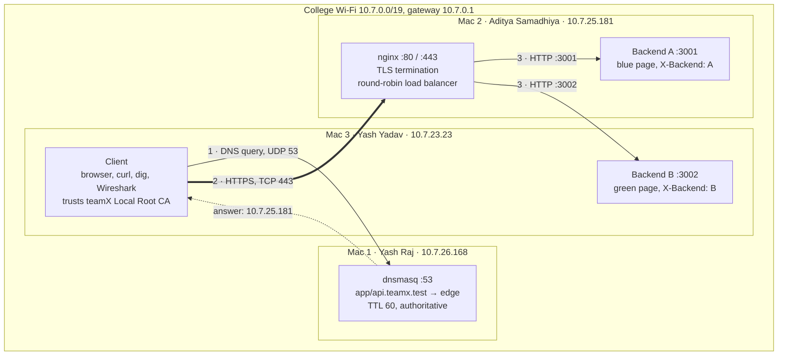
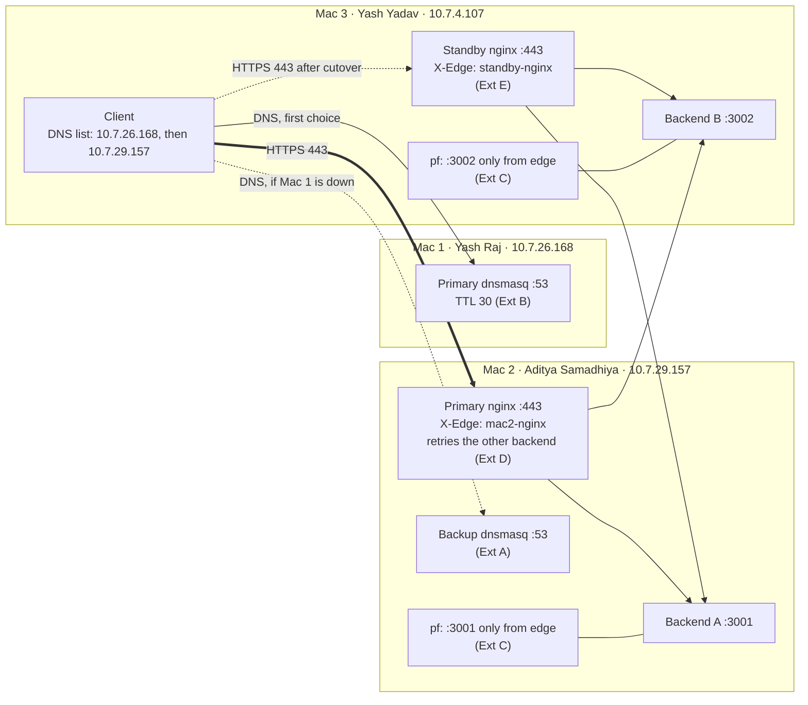
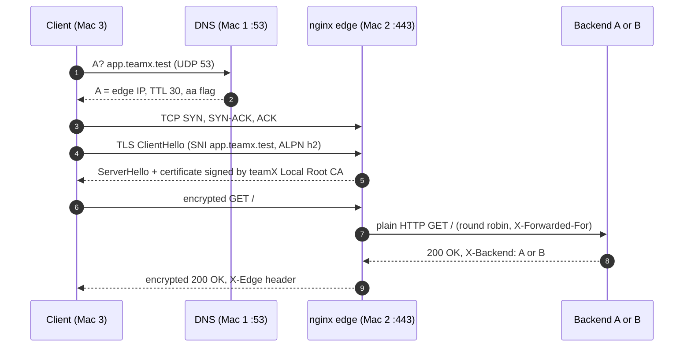

# Computer Network Project (Semester 5): Private Network Service Platform

**Repo:** [github.com/yashraj-a11y/ComputerNetworkProjectSem5](https://github.com/yashraj-a11y/ComputerNetworkProjectSem5) · **Phase 1:** working platform (tasks A–G) · **Phase 2:** resilience extensions (A–F)

A client types `https://app.teamx.test`. **Our own DNS server** resolves the name, the connection goes over **HTTPS to our own nginx edge**, and the edge **load-balances** the request across **two backend servers**. Every step is captured with dig, curl, Wireshark and the browser, on three real MacBooks on one Wi-Fi.

> The application stays simple. The network is the project.

## Team

**Team name:** `teamx` · **Section:** `D` · **Infrastructure:** three physical MacBooks on the same Wi-Fi, four roles (PDF section 3: *"Teams of 2–3 may combine machine roles"*)

| Enrollment no. | Name | Mac | Roles |
|---|---|---|---|
| 2401010514 | Yash Raj | Mac 1, 10.7.26.168 | DNS server (dnsmasq), test client |
| 2401010037 | Aditya Samadhiya | Mac 2, 10.7.25.181 | Edge (nginx reverse proxy, TLS, load balancer), Backend A |
| 2401010515 | Yash Yadav | Mac 3, 10.7.23.23 | Backend B, test client, Wireshark capture |

The roles above are Phase 1. Phase 2 roles and IPs are in [Phase 2](#phase-2-resilience-extensions) below.

## Architecture

### Phase 1: one DNS, one edge, two backends



A request goes 1 → 2 → 3. The client asks our DNS for the name, opens HTTPS to nginx, and nginx forwards plain HTTP to Backend A or B in turn. Clients only ever talk to nginx; the backends stay hidden behind it.

### Phase 2: no single point of failure



Solid lines are normal traffic; dotted lines are the failover paths. If Mac 1's DNS dies, the client asks the backup on Mac 2. If a backend dies, nginx retries the other one in the same request. If the primary nginx dies, both DNS servers are switched to point `app.teamx.test` at the standby on Mac 3.

### One request, step by step



More diagrams, the full IP and service tables, and the layer-by-layer flow: [docs/ARCHITECTURE.md](docs/ARCHITECTURE.md).

## Phase 2: resilience extensions

Phase 2 makes the Phase 1 service survive failures. Report with every measured result: [docs/PHASE2.md](docs/PHASE2.md). Commands per Mac: [docs/PHASE2-RUNBOOK.md](docs/PHASE2-RUNBOOK.md). Screenshots: `evidence/Phase-2-screenshot/`.

| Mac | Member | Phase 2 IP | Phase 2 roles |
|---|---|---|---|
| Mac 1 | Yash Raj | 10.7.26.168 | Primary DNS (dnsmasq) |
| Mac 2 | Aditya Samadhiya | 10.7.29.157 | Primary edge (nginx), Backend A :3001, backup DNS |
| Mac 3 | Yash Yadav | 10.7.4.107 | Backend B :3002, test client, standby edge |

Mac 1 is a college-managed Mac whose application firewall blocks incoming connections to nginx, so in Phase 2 the primary edge runs on Mac 2 and the standby edge on Mac 3. DNS stays on Mac 1. Details in [docs/PHASE2.md](docs/PHASE2.md#why-the-edge-is-on-mac-2-not-mac-1).

| Ext | What it proves | Our result |
|---|---|---|
| A | The name still resolves when the main DNS dies | Mac 1's DNS stopped; the backup on Mac 2 answered and the site kept load-balancing |
| B | A DNS change reaches clients within the TTL (30 s) | Client switched at 11:16:26, about 16 s after the change |
| C | Backends are reachable only through nginx (pf) | Direct `:3001` timed out after 3006 ms; the site still returned A B A B |
| D | A dead backend causes no user errors | nginx log `upstream_status=502, 200`: retried B in the same request |
| E | A standby nginx takes over when the edge dies | 27 s gap (11:33:24 → 11:33:51), mostly the manual cutover |
| F | Live fault diagnosis, layer by layer | Table in [docs/PHASE2.md](docs/PHASE2.md#f-live-fault-diagnosis-viva) |

## Repository layout

```
team.env           ← the ONLY config file: team id, the 3 IPs, ports
backend/server.py  ← the REST backend (stdlib Python, no installs)
dns/               ← dnsmasq template (+ the exact config we ran: dnsmasq.conf.example)
edge/              ← nginx template (+ the exact config we ran: nginx.conf.example)
tls/make-certs.sh  ← local CA + server certificate (OpenSSL)
scripts/           ← one script per job (DNS, edge, backends, client setup, verify, capture, failures)
docs/              ← architecture, TLS, caching, failure demos, Phase 2 report + runbook
ScreenShot-CN/     ← Phase 1 screenshots
evidence/          ← inventory, text output, failure runs, pcap (evidence-0/1/2 = Mac 2/1/3), Phase-2-screenshot/
```

## How to run it (three Macs, Phase 1)

```bash
git clone https://github.com/yashraj-a11y/ComputerNetworkProjectSem5.git
cd ComputerNetworkProjectSem5
```

All 3 Macs on the **same Wi-Fi**, Homebrew installed. `brew install dnsmasq` on the DNS Mac, `brew install nginx` on the edge Mac, Wireshark on the client. The macOS application firewall must allow incoming connections to dnsmasq and nginx (a managed Mac may not allow that; see Phase 2). Put the 3 IPs in `team.env` (identical on all Macs). Run everything from inside the project folder. Phase 2 commands are in [docs/PHASE2-RUNBOOK.md](docs/PHASE2-RUNBOOK.md).

```bash
# all Macs (Task A)
scripts/inventory.sh "Mac N - role" && scripts/ping-matrix.sh

# Task C - backends, each in its own terminal, left running
scripts/backend.sh run A          # Mac 2, port 3001
scripts/backend.sh run B          # Mac 3, port 3002
#   same thing without the script:  python3 backend/server.py --name A --port 3001

# Mac 2 - certificate + nginx edge (Tasks D, E)
scripts/edge.sh certs && scripts/edge.sh start && scripts/edge.sh status

# Mac 1 - DNS server (Task B)
scripts/dns.sh start

# Mac 1, Mac 2, Mac 3 - use our DNS;  Mac 1 + Mac 3 - trust our CA and verify
scripts/client-dns.sh use
scripts/trust-ca.sh
scripts/verify.sh
scripts/capture.sh                # Mac 3: one full DNS→TCP→TLS→HTTP request into a pcap
scripts/failure-demo.sh 1         # … 5  (Mac 3)

# when finished (every Mac that ran them)
scripts/client-dns.sh restore && scripts/trust-ca.sh remove
```

## Backend API

| Endpoint | Response | Caching |
|---|---|---|
| `GET /` | HTML page saying which backend answered (A = blue, B = green) | `no-store` |
| `GET /api/status` | `{"backend":"A","status":"ok", ...}` | `no-store` |
| `GET /api/info` | Same JSON on both backends | `Cache-Control: public, max-age=60` + `ETag`, `If-None-Match` → **304** |
| `GET /healthz` | `ok` | `no-store` |

Every response carries **`X-Backend: A`** or **`X-Backend: B`**.

## Phase 1 checklist → where the proof is (screenshots in `ScreenShot-CN/`)

| Task | Evidence |
|---|---|
| A: Private LAN | `01`–`06` (each Mac: IP, mask, gateway, MAC, ping matrix), `evidence/evidence-*/inventory/` |
| B: Private DNS | `12` (DNS server answer), `13`, `14` (Mac 3 and Mac 2 resolve through Mac 1), `23` (Wireshark) |
| C: Two backends | `07`, `08` |
| D: Reverse proxy + LB | `10`, `11`, `17`, `18`, `19` |
| E: HTTPS / TLS | `09`, `15`, `16`, `20`, `26`–`28` |
| F: HTTP caching | `21`, `22` |
| G: Full protocol flow | `evidence/evidence-2/pcap/`, `23`–`30` |
| 6.3: Failure demos | `31`–`35`, `evidence/evidence-2/failures/` |

## Phase 2 checklist → where the proof is (`evidence/Phase-2-screenshot/`)

| Ext | Screenshots |
|---|---|
| A: Backup DNS | `p2-A1`–`p2-A4` |
| B: TTL 30 + record change | `p2-B1`, `p2-B2` |
| C: pf firewall | `p2-C0`–`p2-C4` |
| D: Backend failover | `p2-D1`–`p2-D3` |
| E: Standby edge + cutover | `p2-E1`, `p2-E2` |

`phase2-2/` holds Mac 2's screenshots and `phase_2-3/` holds Mac 3's.
